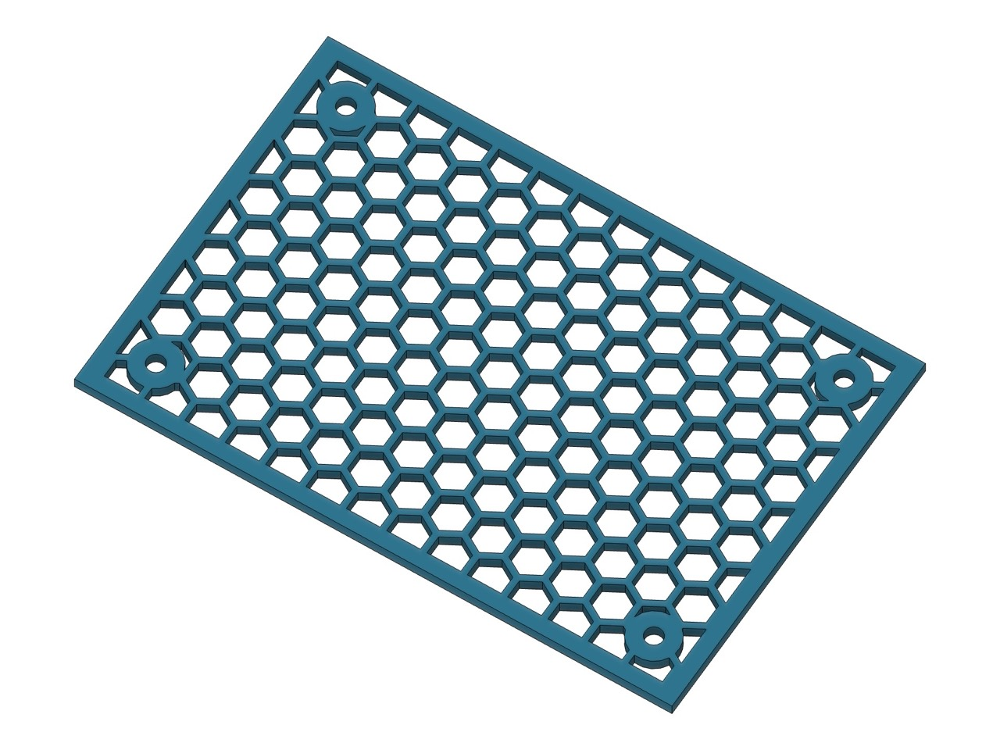
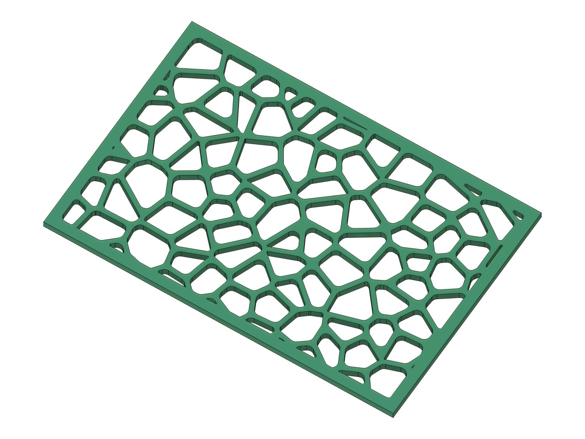
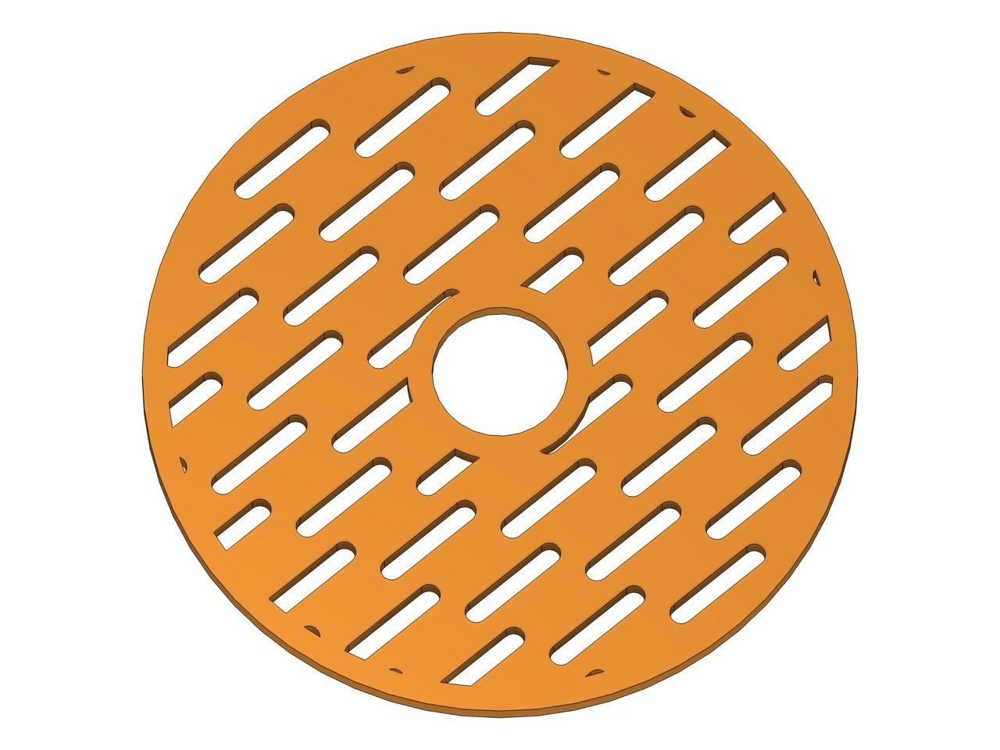
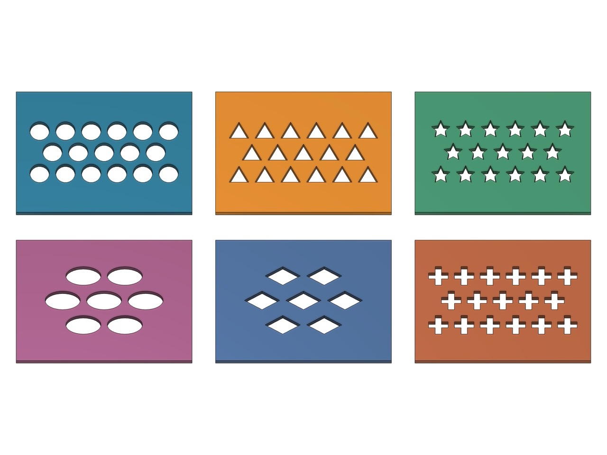
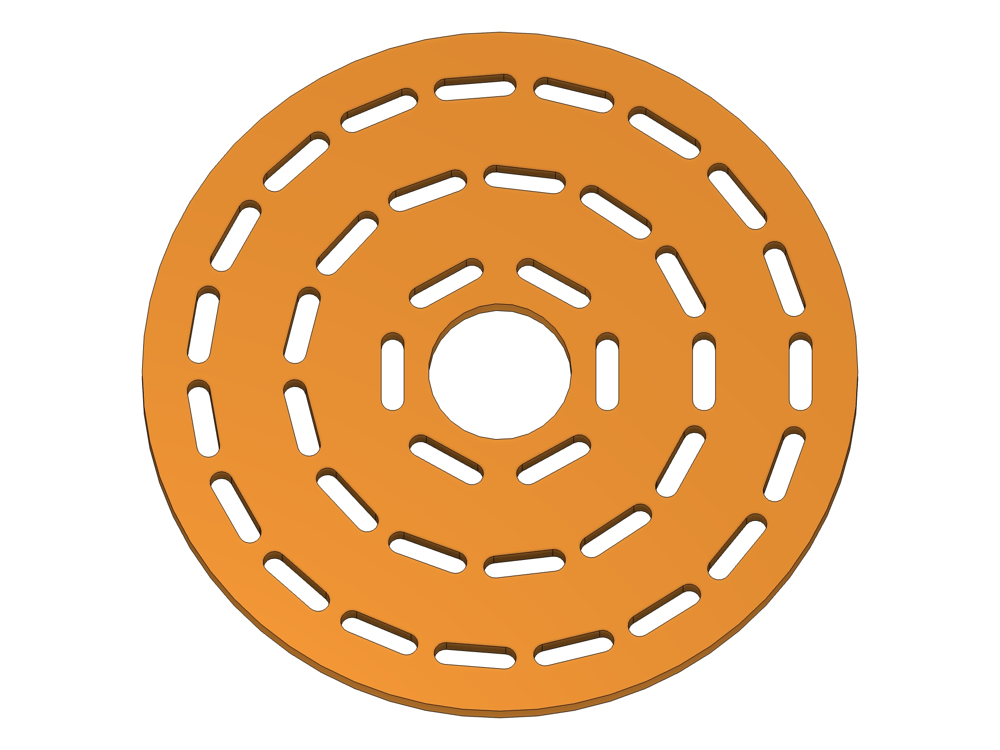
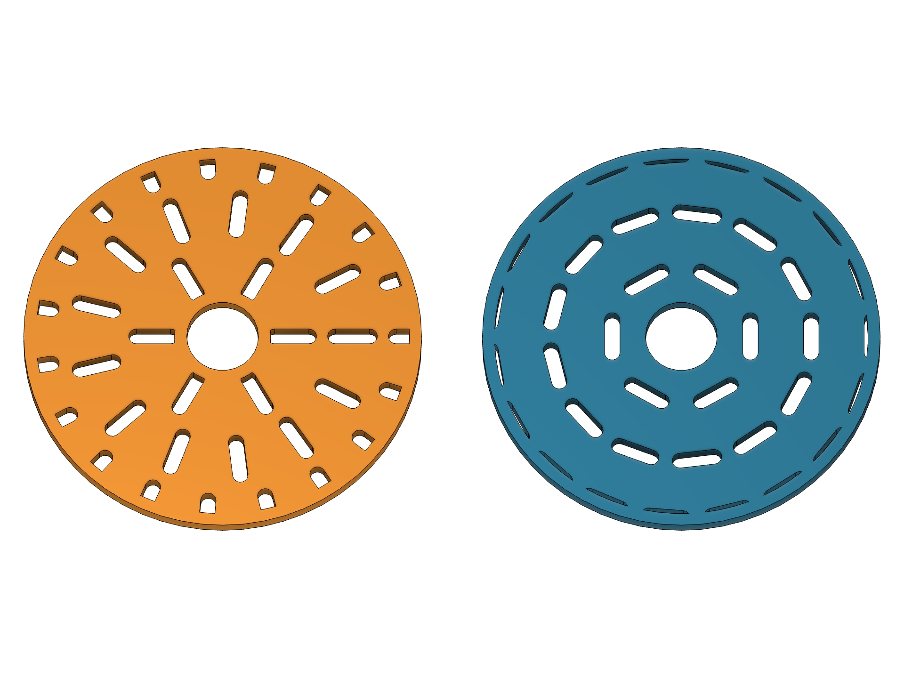
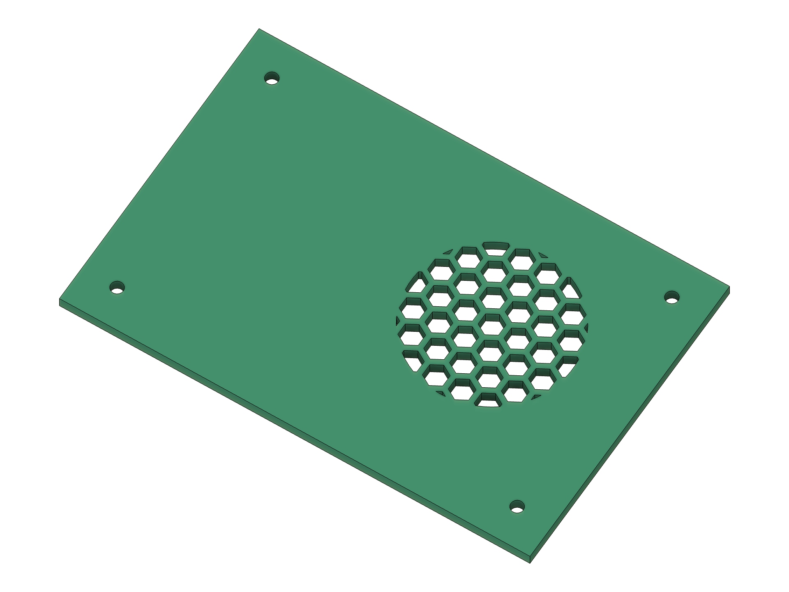
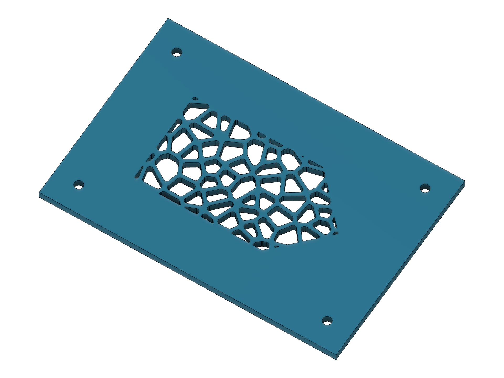
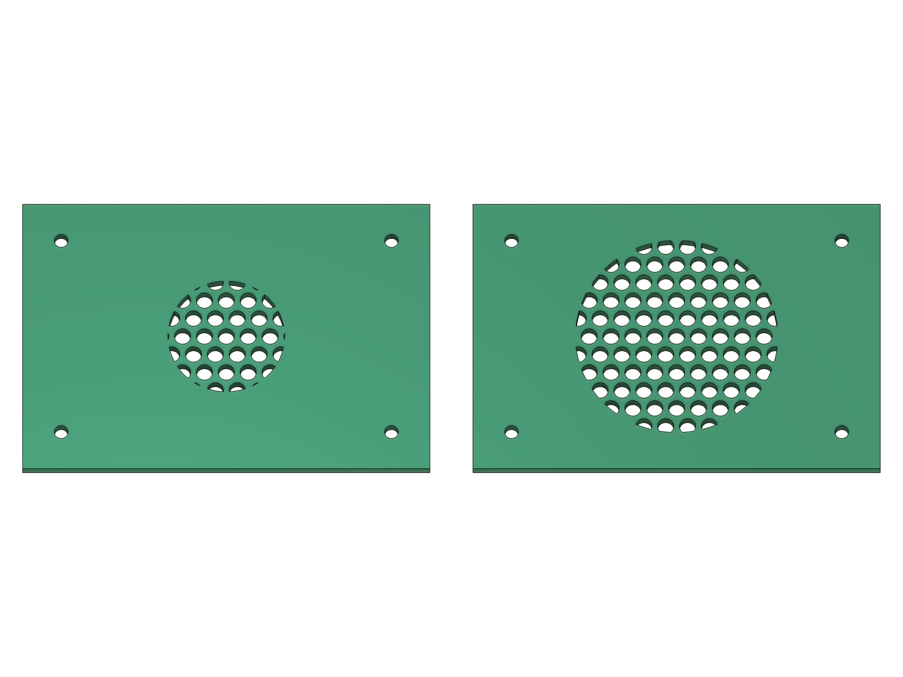
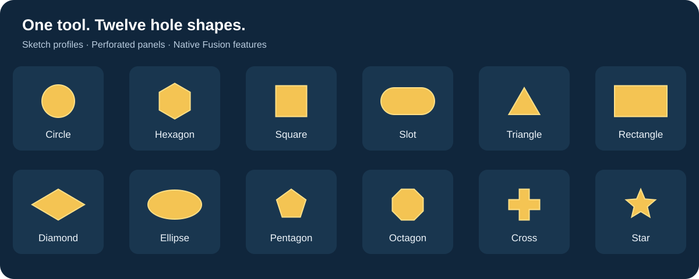

<p align="center">
  
</p>

<h1 align="center">Perfora for Autodesk Fusion</h1>
<p align="center"><strong>Goddess of holes. Precision for Fusion.</strong><br>Hole patterns, ventilation grilles, and perforated panels — without placing every hole by hand.</p>

<p align="center">
  <a href="https://github.com/4FusionLab/Perfora/actions/workflows/ci.yml"></a>
  <a href="https://github.com/4FusionLab/Perfora/releases"></a>
  <a href="LICENSE"></a>
</p>

<p align="center"><a href="https://github.com/4FusionLab/Perfora/releases/tag/v1.0.1"><strong>Download v1.0.1</strong></a> · <a href="README.ru.md">Русский</a> · <a href="https://github.com/4FusionLab/Perfora/issues">Report a problem</a></p>


## Make the pattern. Keep the native model.

Development visual acceptance: [the offline Distribution test](studies/README.md) renders the 11 Distribution families from the shared geometry kernel. New native commands use revision 2 for the revised families, including partial boundary candidates and Follow Pattern orientation. Existing Features retain their saved revision; legacy Running Bond remains editable.

[Pattern playground](demo/README.md) is the browser demo and fast visual test bench. It executes the same Python geometry sources as Fusion, with 11 Distribution families, 19 hole shapes, including six organic fields and shareable parameters. Build with `python3 scripts/build_web_demo.py`; serve the repository and open `/demo/`. It is prepared for static hosting; no deployment is performed by the build.

Select a planar face, a closed sketch profile, or a construction plane. Choose a hole shape, set the spacing and edge clearance, and preview the result. Perfora creates ordinary sketch profiles, a native Fusion Extrude, or a parametric Perfora timeline feature.

To perforate part of an existing face, draw a closed sketch on that face, finish the sketch, and select its shaded profile in **Profiles**. No Split Face is required. For **Cut** or **Intersect**, the supporting body is selected automatically in **Objects**; check the direction and extent before confirming. Profiles on construction planes still require explicit Objects.

**Perfora 1.0.1 fixes Feature Cut recompute after upstream resizing.** Parametric patterns, circular placement, bounded spread, and faster previews. [Release notes →](docs/releases/v1.0.1.md)

**Development branch:** cylindrical, conical and smooth freeform solid faces use the common Sketch/Extrude/Feature workflow, including Voronoi and boundary trimming. This is not in the published 1.0.1 release; see the curved-face behavior and limitations below.

## Made with Perfora

<table>
  <tr>
    <td width="50%" valign="top">
      <a href="docs/assets/examples/honeycomb-panel.jpg"></a>
      <p><strong>Honeycomb grille</strong><br>Hexagonal cells, an outer frame, and mounting holes.</p>
    </td>
    <td width="50%" valign="top">
      <a href="docs/assets/examples/voronoi-panel.jpg"></a>
      <p><strong>Rounded Voronoi</strong><br>An irregular pattern with rounded corners and a defined edge.</p>
    </td>
  </tr>
  <tr>
    <td width="50%" valign="top">
      <a href="docs/assets/examples/slotted-disc.jpg"></a>
      <p><strong>Slots on a circular boundary</strong><br>Partial slots follow the outer edge and central opening.</p>
    </td>
    <td width="50%" valign="top">
      <a href="docs/assets/examples/hole-shapes.jpg"></a>
      <p><strong>A shape for every pattern</strong><br>Circles, triangles, stars, ellipses, diamonds, and crosses.</p>
    </td>
  </tr>
  <tr>
    <td width="50%" valign="top">
      <a href="docs/assets/examples/v1.0.0/circular-tangential.jpg"></a>
      <p><strong>Slots that follow the circle</strong><br>Circular distribution, Tangential orientation, and a clean center opening.</p>
    </td>
    <td width="50%" valign="top">
      <a href="docs/assets/examples/v1.0.0/radial-and-tangential.jpg"></a>
      <p><strong>Choose the direction</strong><br>Radial on the left, Tangential on the right. Fixed orientation is available too.</p>
    </td>
  </tr>
  <tr>
    <td width="50%" valign="top">
      <a href="docs/assets/examples/v1.0.0/point-scoped-perforation.jpg"></a>
      <p><strong>Start here. Stop at this radius.</strong><br>Pick a point and limit the spread without drawing a boundary profile.</p>
    </td>
    <td width="50%" valign="top">
      <a href="docs/assets/examples/v1.0.0/profile-region.jpg"></a>
      <p><strong>Your sketch is the boundary</strong><br>Perforate a profile directly on a solid face. No Split Face.</p>
    </td>
  </tr>
  <tr>
    <td colspan="2" valign="top">
      <a href="docs/assets/examples/v1.0.0/parametric-spread.jpg"></a>
      <p><strong>Change the parameter. Rebuild the pattern.</strong><br>Spread Radius 16 mm and 26 mm; the right-hand Feature recomputes after editing its model parameter.</p>
    </td>
  </tr>
</table>

<details>
<summary>View the twelve regular hole shapes</summary>



</details>

| Control | What you can do |
| --- | --- |
| Pattern | Rectangular, staggered, or circular distribution; web thickness; independent hole and grid rotation; X/Y placement |
| Boundary | Keep complete holes or trim them to the boundary, with an edge offset and clearance around existing openings |
| Output | Hole profiles or a perforated panel; Sketch, native Extrude, or parametric Feature (default) |
| Operation | Join, Cut, Intersect, New Body, New Component |
| Extent | One Side, Two Sides, Symmetric; distance, through-all, or to-object where supported |
| Preview | Cached fast contours for layout; full CAD preview to inspect the extrusion |

See [hole dimensions and geometry notes](docs/PERFORATIONS.md). The interface is in English, using Fusion's native operation names. No third-party Python packages are required.

Every numeric field has a default. Leaving a field empty restores its default after about a second, while allowing you to clear and immediately type a replacement. Explicit zero values are preserved, and nonempty invalid expressions are not replaced. Units, equations, and parameters from the current Fusion document are supported; integer fields retain their range limits.

**Type → Feature** is selected by default when opening Perfora. Sketch and Extrude remain available.

**Preview Color** changes Fast Preview contours: Gold (default), Cyan, Magenta, Green, White, or Black. Switch colors to keep contours visible over selected profiles. Color changes reuse the existing graphics and hole layout. Full Preview uses the Fusion model appearance.

Fusion selection highlighting can tint or cover custom graphics while an entity is selected; the thicker contours improve contrast, but Preview Color does not override Fusion selection colors.

## Voronoi

**Voronoi** was introduced as the thirteenth hole shape in 0.2.0 and remains the last entry. Select **Hole Shape → Voronoi**, then adjust **Cell Spacing**, **Irregularity (%)**, and **Seed**. **New Pattern** advances the seed while keeping the other settings. A seed reproduces the same pattern for the same source and settings.

Cell Spacing controls the nominal distance between sites, rather than the size of every hole. Irregularity ranges from regular square cells at 0% to varied convex polygons at 100%. **Web Thickness** sets the minimum gap between holes; a large web can consume small cells. **Distribution** and **Hole Angle** are hidden in this mode. Pattern rotation, X/Y offsets, edge clearance, exact trimming, Fast/Full Preview, sketch profiles, and native Extrude remain available.

Enable **Round Corners** to add tangent circular fillets to the Voronoi holes. **Corner Radius** sets the maximum radius. Short bevels are absorbed by the rounded contour; the radius is reduced only when the hole is too narrow. Rounding is off by default and preserves the minimum web. Fast Preview follows the same arcs used by the sketch and Extrude. New convex corners at straight and circular trim boundaries are rounded too. Existing concave source corners and elliptical/spline boundary segments retain their exact geometry.

## Organic patterns (development)

Six additional **Hole Shape** entries precede Voronoi: **Smooth Noise**, **Reaction Diffusion**, **Directional Fibers**, **Ridged Noise / Topographic**, **Gyroid Field**, and **Blue Noise / Size Gradient**. Voronoi remains last; the original 13 shape IDs and saved parameters are unchanged. These additions are unpublished.

The first five use **Pattern Scale**, **Field Fill (%)**, **Direction**, **Seed / New Pattern**, **Web Thickness** and **Edge Offset**. Field Fill controls the raw threshold, so bridges, rounded tips, webs and trimming reduce the final open area. Blue Noise uses **Maximum Diameter**, **Size Variation (%)** and a signed **Size Gradient (%)**, with radius-aware spacing. It complements the existing fixed-size Poisson Disk Distribution.

**Add Bridges** is a separate checkbox, off by default, for extra local breaks in long openings. Its state is saved in Feature and restored during editing. Minimum web and material-island protection remain active.

These shapes define their own bounded field; Distribution, Pattern Angle and Hole Angle are hidden. Direction rotates the field in sketch axes. On a curved face, 0° follows the circumferential chart axis and 90° follows the axial/meridian axis, including fibers. All six connect to Sketch, Extrude, Feature, Fast/Full Preview, Trim to Boundary and inner-cutout clearance on planar, cylindrical, conical and regular freeform sources. Multiple selections must still have one surface type. Curved openings are finite straight tools, with conservative seam/depth separation; the motif can become sparser at high curvature or a cone tip.

Material islands are joined before contour extraction. Overlong slots receive bridges; conflicting small fragments are omitted to protect the actual contour web. With a zero edge border, boundary fragments that would detach material are retained as solid material. Sampling and contour budgets give actionable errors instead of unbounded CAD work. See [algorithms, controls, surface behavior and validation](docs/ORGANIC_PATTERNS.md).

## Multiple regions (development)

This branch adds up to **32 regions of one surface type** in **Profiles**, with common settings and one combined **Maximum Holes** limit. Planar faces and profiles may be combined; cylinders, cones and freeform faces remain separate types. This feature is unpublished. Construction planes remain single-source. Sketch creates one sketch per region, including fixed 3D contours on curved faces. Extrude uses native extrusion on planar sources and Base Feature/Combine on curved sources. Feature groups all regions in one parametric timeline node.

For several planar regions, the default origin is the component origin projected onto each plane. The pattern X axis follows projected component X, switching to projected component Y near an X-normal plane; Y completes a consistent plane frame. Coplanar regions share the same lattice phase, including Voronoi and Circular, regardless of selection order. **Start Point** overrides the origin and is projected onto each plane. X/Y Offset and Pattern Angle use these shared plane axes (offsets use pattern axes for grids/Voronoi). Saved legacy Spread Radius parameters remain supported. Extrude direction follows each source sketch normal; inspect Full Preview for opposite-facing sources. Returning to a single source restores the existing automatic-center behavior.

Repeated references are ignored. Positive-area overlaps are rejected before output is created; adjacent regions stay separate and each retains its own Edge Offset and internal openings. All regions must belong to one component occurrence. Cut/Intersect maps a face or face-backed profile to its supporting body, which must be included in Objects. Profiles without a supporting body require exactly one Object. Intersect requires one region per Object; unused or ambiguous Objects are rejected. Feature Join uses the same explicit mapping; native Extrude Join retains Fusion's automatic touching-body behavior. Multiple-region New Component is rejected; use New Body or a single source. Existing single-source operations remain available.

Feature stores all source dependencies and its Objects mapping; source set, operation, and Objects remain fixed in Edit Feature. Older single-source Features remain readable/editable. Full Preview/OK use fresh source geometry and the same canonical layout as Fast Preview; failures remove all new output, and recompute attempts to restore every changed base body if one update fails. **Current native CAD/UI and local F3D results are recorded in the [integration report](docs/RELEASE_INTEGRATION.md).** [Binding rules and acceptance checklist](docs/MULTI_REGION.md).

## Parametric Feature

**Type → Feature** creates one **Perfora** node in the timeline. With the add-in running, changing its model parameters or upstream source geometry regenerates the pattern, including the number of holes. Double-click the node or choose **Edit Feature** to edit the pattern, trimming, placement, profile type, and thickness. Expressions can reference Fusion user parameters. OK commits the edit; Cancel restores the previous model.

All 13 shapes, exact trimming, rounded Voronoi holes, Fast/Full Preview, and **Join**, **Cut**, **Intersect**, **New Body** are supported. **Capture Design History** is required. This initial mode supports **Distance** with zero taper and **One Side**, **Two Sides**, **Symmetric**. Source, operation, and target bodies stay fixed during edit. Use Extrude for **All**, **To Object**, taper, or **New Component**.

Keep Perfora running to edit or recompute the feature. Large topology changes can invalidate downstream face/edge references. The mode uses Autodesk's [Custom Feature API](https://help.autodesk.com/cloudhelp/ENU/Fusion-360-API/files/CustomFeatures_UM.htm), which remains in Preview.

Since **1.0.1**, Feature Cut preserves its target when an upstream face shrinks with **Trim to Boundary** and a nonzero **Edge Offset**. The regression covers a box height change from 70 mm to 20 mm and back, including rounded Voronoi holes.

## Pattern origin and spread

**Start Point** is available for Staggered, Rectangular, Circular, and Voronoi. Use the native Select control to pick a sketch point, model vertex, or construction point; points on other planes are projected onto Profiles. Clear the selection for automatic placement. X/Y Offset add displacement from this point (in pattern axes for grids/Voronoi, sketch axes for Circular).

Spread Radius has been removed from the command. New patterns fill the selected boundary; choose a boundary profile to limit the area. Existing Feature model parameters and their saved spread limits remain supported for compatibility.

## Circular distribution

**Distribution → Circular** places holes on concentric rings. It supports all 12 repeating shapes; Voronoi keeps its own distribution. Available in the stable 1.0 release. In this development branch, rings retain their chord-packed layout (six holes on the first regular ring), with even counts preserving opposite site pairs and central symmetry for centered circular holes. Offsets, asymmetric hole contours and existing openings can change the final symmetry.

- **Start Radius** measures the first ring to hole centers. At 0, the pattern starts with one center hole; a positive value omits that hole. This does not specify a solid central zone: holes may extend inside the first ring.
- Holes per ring and radial spacing are automatic, based on the shape size and **Web Thickness**. Chord spacing preserves the web across each ring's closing seam. Noncircular shapes use conservative enclosing bounds, so actual webs can be wider than requested.
- **Orientation → Fixed** keeps holes parallel; **Radial** rotates each hole with its radial position. **Tangential** follows the circumference. **Hole Angle** adds a rotation in all three modes. Orientation is hidden for circles.
- **Start Point** uses Fusion's native Select control: pick a sketch point, model vertex, or construction point. Points on other planes are projected onto the Profiles plane. Clear the selection to use the outer boundary's bounding-box center. **X Offset / Y Offset** move the pattern relative to the selected point or automatic center, in sketch axes without periodic wrapping. **Pattern Angle** rotates the pattern about this center without moving the center itself.
- **Edge Offset**, internal openings, **Trim to Boundary**, Fast/Full Preview, profiles and Extrude operations remain available. In Feature mode, the selected point is a dependency: moving it recomputes the pattern, and Edit Feature can replace or clear it. Ring radii and spacing are set before trimming; changing the boundary can move the pattern with its bounding-box center.


## Development branch: eight more distributions

**Validated in Fusion on macOS; exact coverage is in the [integration report](docs/RELEASE_INTEGRATION.md).** This working branch adds **Contour, Fan, Phyllotaxis, Poisson Disk, Wave, Chevron, Running Bond, and Between Curves** for all 12 repeating hole shapes. Voronoi keeps its own distribution; Rectangular, Staggered, and Circular remain available.

Native fields, shared Fast/Full Preview and Sketch/Extrude/Feature paths, parameter storage, guide dependencies, Edit Feature restoration, and older Feature defaults are implemented in source. Offline geometry/contract tests and native CAD/UI acceptance on macOS pass; see the [integration report](docs/RELEASE_INTEGRATION.md) for exact coverage. Published v1.0.1 does not contain these additions.

Along Spacing and Row Spacing use automatic enclosing-hole spacing at 0; smaller requested pitches are raised to the safe minimum. A spatial neighbour index omits candidates that could violate Web Thickness, including rotated shapes, fan centers, contour seams, and chevron vertices. Packing is conservative. Phyllotaxis has Density Ratio; saved Spread Radius parameters remain compatible; Poisson Disk has Seed/New Pattern; Wave uses length-based sampling, amplitude/wavelength/phase/row phase; Running Bond accepts cumulative shifts such as `1 / 3` and `1 / 4`.

Contour follows approximate signed-distance levels, with explicit Contour Tolerance and a sampling budget; it is not an exact CAD offset, and sub-resolution details can disappear. Between Curves currently requires two separate open planar curves/edges in the Profiles component, matches normalized arc length and endpoints, and rejects crossed, collapsed, folded, closed, nonplanar, or cross-component guides. Arbitrary complex spline strips and curve chains are not promised. For Contour/Between Curves, Start Point and offsets affect only saved legacy Spread Radius scopes; Pattern Angle is hidden.

New Feature nodes expose the added model parameters. Older nodes keep missing values as stored snapshots when edited; recreate a Feature to obtain new model parameters and their expression dependencies. [Implementation limits, integration seam, and CAD/UI acceptance →](docs/LAYOUT_VARIANTS.md)
## Along Path (development)

The integrated development branch adds **Distribution → Along Path** for all 12 repeating shapes: select one coplanar line, arc, circle or spline in the Profiles component. **Path Spacing** measures arc length; **Start Offset**, **End Offset**, **Position** and **Reverse Path** control placement. **Fixed** or **Tangent** orientation adds **Hole Angle**. Closed paths omit duplicate seam centers. Tight turns, nearby sections and the closing seam are checked against Web Thickness using conservative enclosing bounds; conflicts are reported rather than silently skipping holes.

The implementation connects to Fast/Full Preview, existing trimming/inner cutouts/Edge Offset, Sketch, Extrude and Feature. Feature stores a live path dependency and new native path parameters; Edit Feature can replace the path or change distribution. Older nodes remain compatible with existing distributions; recreate them to use Along Path, because existing nodes cannot gain its native parameters. Chains, off-plane/cross-component paths and elliptical paths are unsupported. Start Point, Spread Radius, Pattern Angle and X/Y Offset are inactive in this distribution; Voronoi keeps its own distribution.

**This functionality is unpublished.** Native CAD/UI, recompute/edit, Undo/Redo and local F3D acceptance are recorded in the [integration report](docs/RELEASE_INTEGRATION.md). [Behavior, API rationale, tolerances, limitations and CAD acceptance →](docs/CURVE_LAYOUT.md)

## Performance

Measured before/after results include **3.424 → 0.262 s** for a 45-hole elliptical Fast Preview and **1.148 → 0.104 s** for 253 hexagons in a circular region. These are paired measurements in Fusion on macOS, not universal speed guarantees. [Benchmark data, scenarios, and methodology →](docs/BENCHMARKS.md)

Fast Preview and final creation reuse the current command's prepared hole layout. Changing extrusion settings still applies the current values to the final result. Changes to the source geometry, plane, point, radius, or layout invalidate the corresponding data. Clipped hole previews defer panel-only Boolean work until Perforated Panel is selected. Small simple patterns keep a direct clearance-check path.

The optimizations preserve hole contours, clearance checks, Voronoi Seed, and exact trimming. Building many native sketch curves and profiles can still dominate the total time; geometry-generation speedups do not apply uniformly to the whole command.

## Install

**Requires Autodesk Fusion on macOS or Windows. No terminal or separate Python installation is needed for the recommended method.** Perfora runs using the Python runtime included with Fusion. Linux is supported for tests and packaging only.

### Recommended: add the folder in Fusion

1. Download **[Perfora-1.0.1.zip](https://github.com/4FusionLab/Perfora/releases/download/v1.0.1/Perfora-1.0.1.zip)** from the [release page](https://github.com/4FusionLab/Perfora/releases/tag/v1.0.1) and extract it to a permanent location.
2. In Fusion, open **Utilities → Scripts and Add-Ins**.
3. Click **+ → Script or add-in from device**.
4. Select the inner **`Perfora`** folder containing **`Perfora.py`** and **`Perfora.manifest`**, not the top-level extracted folder.
5. Select **Perfora** and click **Run**. Optionally enable **Run on Startup**.

Fusion remembers a link to this folder. **Keep it in place: do not move or delete it after adding it.** The command appears in **Design → Solid → Create**, or press **S** and search for **Perfora**.

This folder-linking method is [supported by Autodesk](https://help.autodesk.com/cloudhelp/ENU/Fusion-360-API/files/WritingDebugging_UM.htm).

### Optional: installer with automatic backups

If you already have Python 3 installed, you can instead open a terminal in the extracted folder and run:

```sh
# macOS
python3 install.py

# Windows
py -3 install.py
```

The installer copies the add-in to Fusion's API directory and installs the optional CAD smoke-test script. Existing Perfora installations are backed up outside AddIns/Scripts; automatic startup is disabled. It prints the installed location. In Fusion, select **Perfora → Run** in Scripts and Add-Ins; add the printed `Perfora` folder with **+** if it is not listed.

To specify the Fusion API directory: `python3 install.py --api-root "/path/to/Fusion/API"`.

**Updating Perfora:** stop and unlink the old copy before adding the new folder. Restart Fusion before using Feature from a different folder: switching copies with the same add-in UUID in one session can retain the previous Feature owner. Keep one copy running.

**Upgrading from Perforator:** stop and unregister the old add-in before running Perfora. The old folder is not removed automatically. Do not run both versions together; command IDs and document attributes are intentionally compatible.

## Two starting points

**Vent a box wall:** select a planar face → set Hole Shape, Web Thickness, and Edge Offset → Extrude → Holes → Cut → All → check direction and Objects → OK.

**Build a separate grille:** select a closed sketch profile or construction plane → set the pattern → Extrude → Perforated Panel → New Body or New Component → set thickness → OK.

On a construction plane, Boundary defines a centered rectangle or circle. **Trim to Boundary** includes partial holes along the edge; **Edge Offset** remains active. On planar sources, a complete hole exactly meeting Edge Offset is retained with either setting; the whole-hole check does not add a hidden clearance.

## Know the limits

### Curved faces — development branch

Select one cylindrical, conical, or regular smooth freeform face of a solid body in **Profiles**. The same **Type → Sketch / Extrude / Feature**, **Pattern**, **Placement**, and **Extrude** sections are used for planar and curved sources. Spheres, tori, meshes, singular patches, and patterns spanning multiple faces are excluded. These capabilities are not part of the published 1.0.1 release.

All 12 repeating shapes and **Voronoi** are available, with Seed/New Pattern, Irregularity, Round Corners, Rectangular/Staggered rows, Start Point and offsets. Circular and Pattern Angle are available only for planar sources; rotating a flat chart does not create a consistent wrapped pattern. Voronoi defines its own distribution. On cylinders and cones, **Boundary** also offers Start Angle, Sweep Angle, Axial Start and Axial Length (0 uses the remaining height). Closed cylindrical sites are periodic without a duplicated seam cell. Conical rows use physical meridian spacing and compute their own hole counts from the local circumference and tool depth. Additional holes appear toward the base instead of letting the narrow tip limit the whole pattern. Rectangular keeps the same angular start direction; Staggered offsets alternate rows by half their local angular pitch. Individual columns may branch as the row count changes. Sites too near the apex are omitted.

Dimensions describe straight tool sections in the tangent plane at each site, rather than an exact wrapped shape or constant geodesic dimensions. **Distance**, Start Offset, Flip Direction, One Side, Two Sides and Symmetric control bounded local tools. Freeform row coordinates use physical iso-section lengths and an inverse arc-length map, eliminating UV stretching on extruded faces. Repeating-hole pitch also accounts for convergence through tool depth. A globally equidistant flat grid is not guaranteed on doubly curved surfaces. Conical rows and 3D clearance checks remain conservative: actual webs can be wider, and conflicting sites are omitted without changing hole dimensions. Sites whose local boundary crosses a fold are omitted while other regular parts of the face remain usable. A NURBS boundary collapsing to a pole no longer rejects the whole face: interior regularity is checked separately, and local trim envelopes containing the pole are omitted. Large faces may require a higher Maximum Holes setting. The spacing filter checks finite tools in 3D, including automatic surface leads, instead of using the worst curvature of the whole face. All and To Object extents, taper and Perforated Panel currently require planar sources.

**Trim to Boundary** keeps partial holes. **Edge Offset** stays active at the source/zone boundary and around existing openings. Exact projected BRep curves define local trim masks; rectangular masks use an exact inset. Other outlines use swept boundary exclusions with an extra 0.002 mm clearance for the bounded curve-stroking error. Offset is conservative in local projection, not a geodesic surface offset.

**Sketch** creates fixed 3D surface contours; they are not planar Extrude profiles. **Extrude** creates fixed straight tools in a Base Feature plus native Combine for Join/Cut/Intersect, or New Body/New Component. It is not a single native Extrude feature. **Feature** owns those tools and operations, stores expressions/dependencies, regenerates after parameter/source changes, and supports **Edit Feature**. Feature supports Join/Cut/Intersect/New Body; source, operation and targets remain fixed during edit. Solid outputs require Capture Design History. Finite face angles are passed without rounding to Fusion display precision; preselected faces initialize their own full zone. Keep cylinder/cone tool bounds below the radius; inspect Full Preview to check wall penetration.

Fast Preview and final solids share the same preparation path. Cached color/section changes do not rebuild the layout. Full Preview uses the actual solid operation and Cancel rolls it back.

Native CAD acceptance is recorded for Fusion 2706.1.14 on macOS 27.0.1, including local F3D reopen. Windows CI checks Python code and installation; native Windows Fusion CAD, cloud save/reopen, and complex assemblies are not claimed as tested.

- Edge Offset must leave a valid inset; touching or intersecting offset loops can be rejected by Fusion.
- Curved sources use the development workflow described above. Spheres, tori, singular faces and mesh bodies are unsupported.
- Sketch and Extrude outputs keep a fixed hole layout. Use Feature to regenerate the pattern.
- Native Extrude parameters remain editable in Fusion. Source and Cut/Intersect target bodies must belong to the same component. Editing a component affects all its occurrences.
- The default limit is 1,500 holes, configurable up to 5,000. Dense patterns and full previews take longer. Some rotated shapes use conservative spacing, so the actual web can be wider than requested.

## Next-release feature set

This local branch combines cylindrical, conical and freeform faces, eight new distributions, Along Path, and up to 32 regions of **one surface type** in one component. Planar faces and planar sketch profiles may be combined. Planar, cylindrical, conical and freeform sources cannot be mixed. Repeated references are deduplicated. Construction Plane remains a single source. Maximum Holes applies to the complete selection.

| Source | Repeating-hole distributions |
| --- | --- |
| Planar | Staggered, Rectangular, Circular, Along Path, Contour, Fan, Phyllotaxis, Poisson Disk, Wave, Chevron, Running Bond, Between Curves |
| Cylinder | Staggered, Rectangular, Running Bond, Poisson Disk |
| Cone | Staggered, Rectangular, Running Bond |
| Freeform | Staggered, Rectangular, Running Bond, Poisson Disk, Wave, Chevron |

Voronoi retains its own distribution on all supported surface types. Conical Running Bond maintains the fractional row shift while adapting row capacity to local radius. Centered motifs and planar guides stay on planar sources; Chevron and Wave are not offered on surfaces of revolution. Unsupported combinations produce an explicit error during recompute too.

Multiple regions support Sketch, Extrude and one parametric Feature node. Coplanar regions share one phase; curved regions follow their local normals. All regions are prepared before modifying the first body. Conservative finite-tool checks reject conflicts across neighboring curved regions without resizing holes. Intersect requires a separate target body for each region. New Component remains available for a single source.

These features are unpublished. The manifest remains 1.0.1 pending the release version decision. See [RELEASE_INTEGRATION.md](docs/RELEASE_INTEGRATION.md) for actual acceptance and limitations.


## Development

```sh
python3 -m unittest discover -s tests -v
python3 install.py --zip
```

The build produces `dist/Perfora-1.0.1.zip` and its `.sha256` file. Version comes from the add-in manifest. CI checks geometry and installation on macOS, Windows, and Linux, then publishes verified 1.x versions as stable releases marked Latest. The earlier 0.x versions remain prereleases. Native Fusion checks run separately.

[Contributing and CAD checks](CONTRIBUTING.md) · [Changelog](CHANGELOG.md) · [Release process](docs/PUBLISHING.md)

## A little workshop mythology

Perfora is the goddess of holes, guardian of clean edges, and sworn enemy of repeating the same pattern by hand — from **4FusionLab's own mythology**, with a playful nod to ancient Greece.

[GPL-3.0-only](LICENSE). An independent **4FusionLab** project, not affiliated with or endorsed by Autodesk. Native operation icons are resolved from the user's Fusion installation; Autodesk graphics are not bundled.

Large organic fields adapt their sampling within 8–16 samples per Pattern Scale and the fixed node budget. Previously accepted small regions retain their grid; physical Pattern Scale and Web Thickness stay explicit.

The native Pattern Type selector separates Pattern (13 hole shapes, with Voronoi last) from Organic Field (six fields). Each family retains its selected shape; only relevant controls are shown. The browser playground uses the same two-family navigation.
