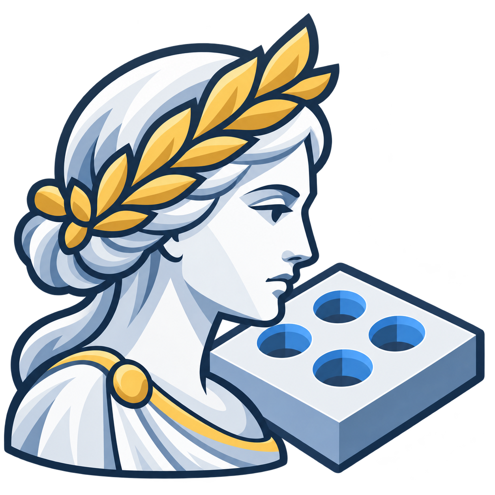
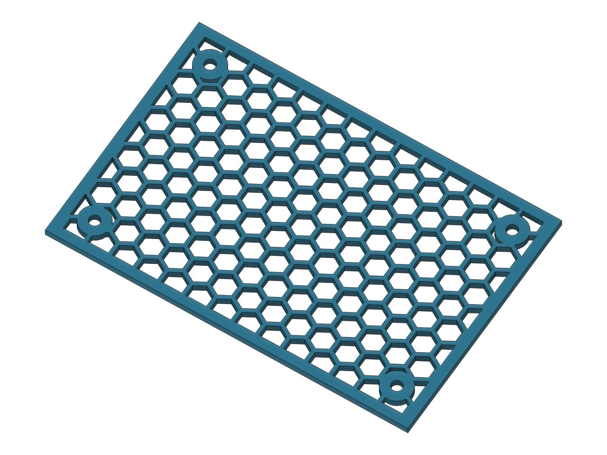
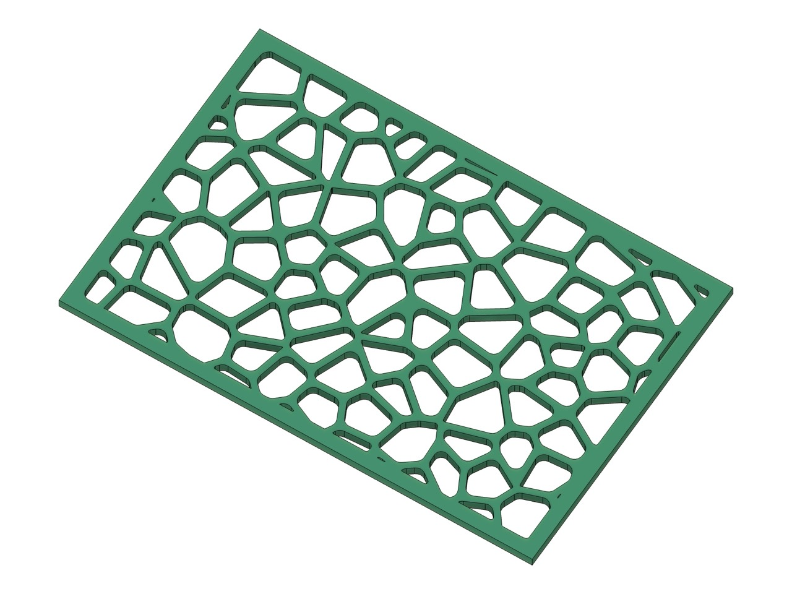
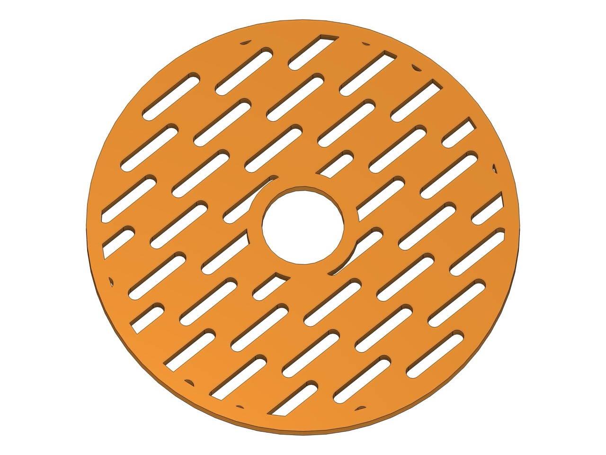
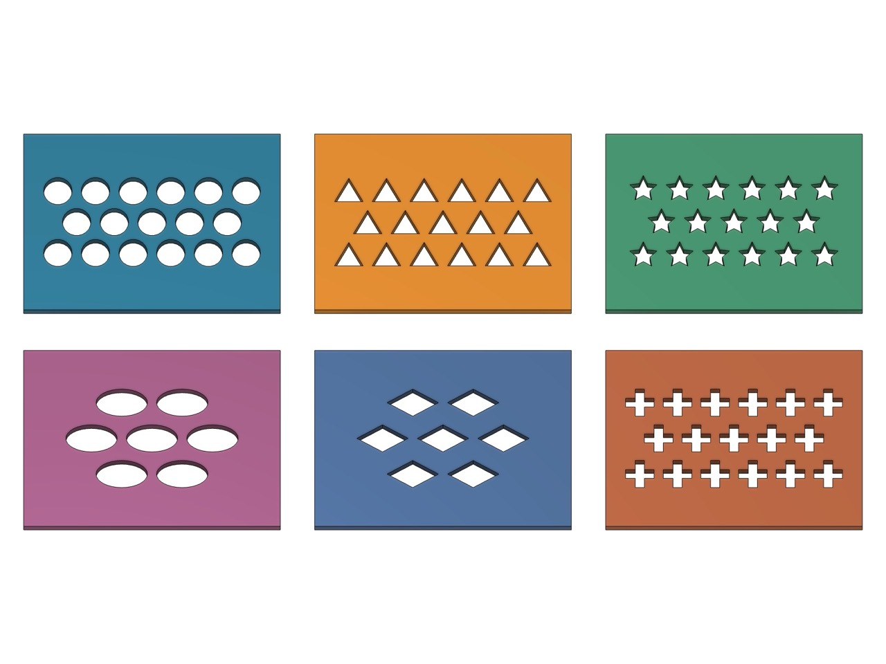

<h1 align="center">Perfora for Autodesk Fusion</h1>

<strong>Goddess of holes. Precision for Fusion.</strong> Create perforations, ventilation grilles, and decorative patterns — without placing every hole by hand.

  
  
  

<a href="https://github.com/4FusionLab/Perfora/releases/latest"><strong>Download Perfora</strong></a> · <a href="README.ru.md">Русский</a> · <a href="https://github.com/4FusionLab/Perfora/issues">Report an issue</a>

Perfora is an open-source **Fusion 360 add-in** for creating procedural perforation, hole patterns, honeycomb ventilation grilles, Voronoi patterns, and perforated CAD panels.

---

## See what you can make

<table>
<tr>
<td width="50%"> <strong>Ventilation grilles</strong> Regular, precise openings.</td>
<td width="50%"> <strong>Organic patterns</strong> Voronoi and irregular designs.</td>
</tr>
<tr>
<td width="50%"> <strong>Circular layouts</strong> Radial and tangential patterns.</td>
<td width="50%"> <strong>Shape variety</strong> Make the pattern your own.</td>
</tr>
</table>

## What Perfora does

- **Flexible patterns:** 12 repeating hole shapes, 11 distribution families, six organic fields, and Voronoi.
- **Control the boundaries:** adjust spacing, web thickness, edge clearance, rotation, and trimming.
- **Work on your model:** select supported planar or curved faces, sketch profiles, or construction planes.
- **Choose the result:** sketch geometry, Fusion extrusion, or a parametric timeline feature.
- **Preview before applying:** inspect your pattern and adjust it in place.

Feature availability depends on the selected surface and output mode. See [supported combinations and limitations](docs/README_REFERENCE.md#surface-and-distribution-availability).

## Get started

1. Download the add-in from the **[latest release](https://github.com/4FusionLab/Perfora/releases/latest)** and extract the archive to a permanent folder.
2. In Autodesk Fusion, open **Utilities → Scripts and Add-Ins**.
3. Choose **+ → Script or add-in from device**, then select the folder containing `Perfora.py` and `Perfora.manifest`.
4. Select **Perfora → Run**. Find the command in **Design → Solid → Create**, or search for *Perfora* with **S**.

Works with Autodesk Fusion on **Windows and macOS**. Keep the installed folder in place. No separate Python installation is required for this method.

## Learn more

[User guide and detailed reference](docs/README_REFERENCE.md) · [Hole geometry](docs/PERFORATIONS.md) · [Organic patterns](docs/ORGANIC_PATTERNS.md) · [Release notes](docs/releases/v1.1.0.md) · [Changelog](CHANGELOG.md)

[Contributing](CONTRIBUTING.md) · [License](LICENSE) · [Report a problem](https://github.com/4FusionLab/Perfora/issues)

**Other Fusion 360 tools by 4FusionLab:** [Selectra — select similar geometry](https://github.com/4FusionLab/Selectra) · [Ejix — extract solid volumes](https://github.com/4FusionLab/Ejix) · [RuEn — Russian-layout shortcuts](https://github.com/4FusionLab/RuEn) · [Planara — planned surface flattening](https://github.com/4FusionLab/Planara)

## A little workshop mythology

**Perfora**, goddess of holes, guards clean edges and saves makers from repeating the same pattern by hand. She belongs to the original mythology of **[4FusionLab](https://github.com/4FusionLab)**.

Independent project, not affiliated with or endorsed by Autodesk.
