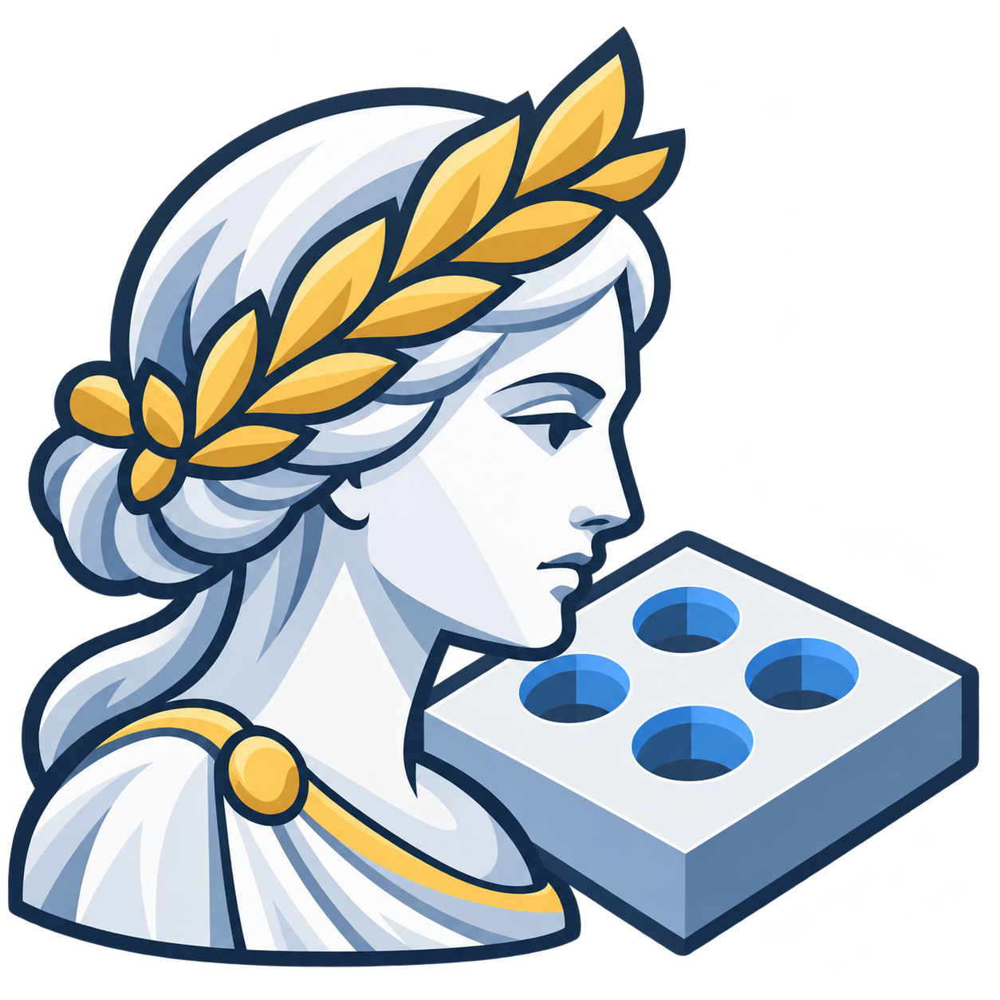
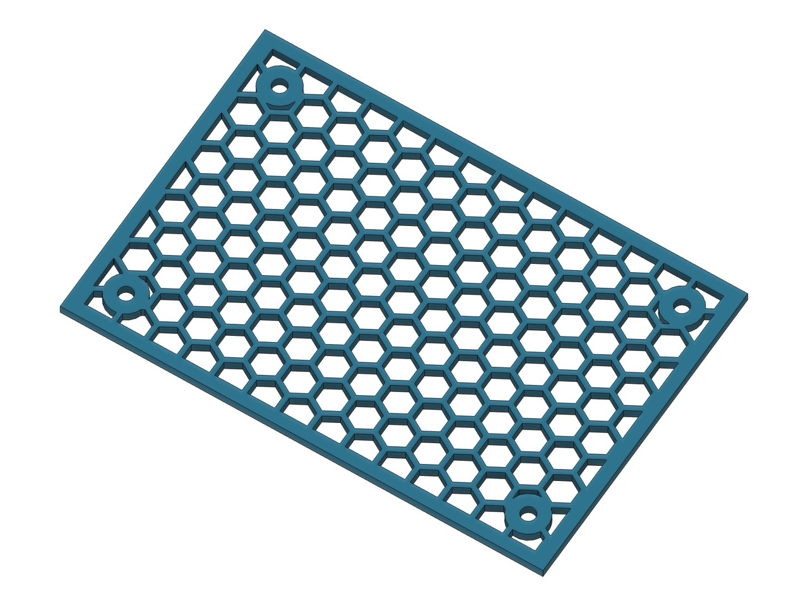
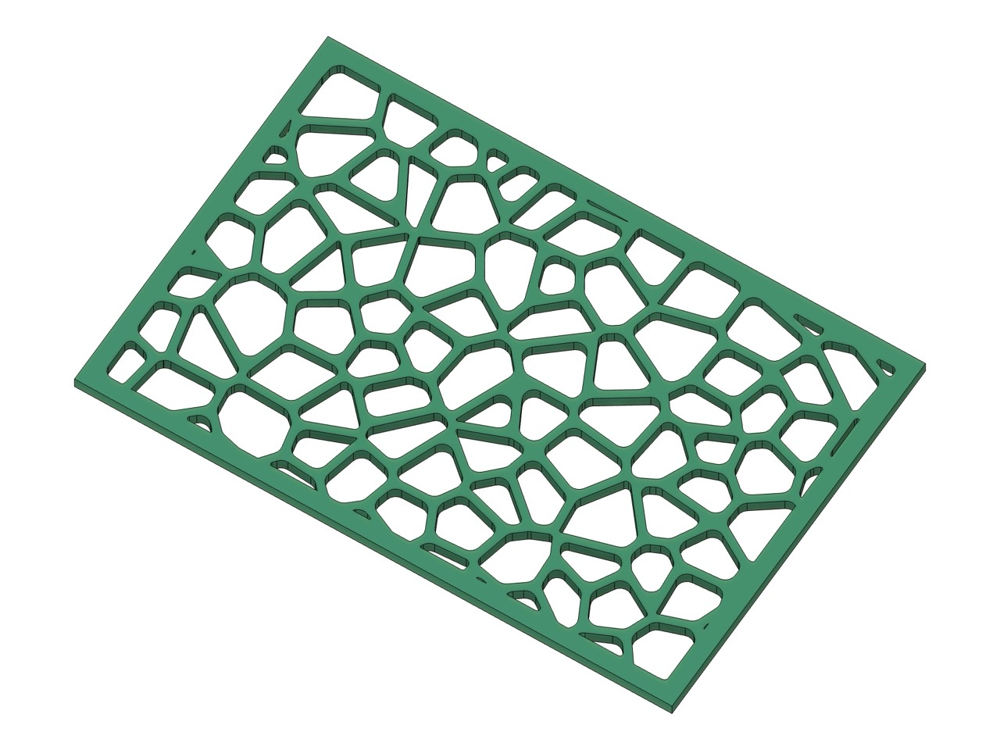
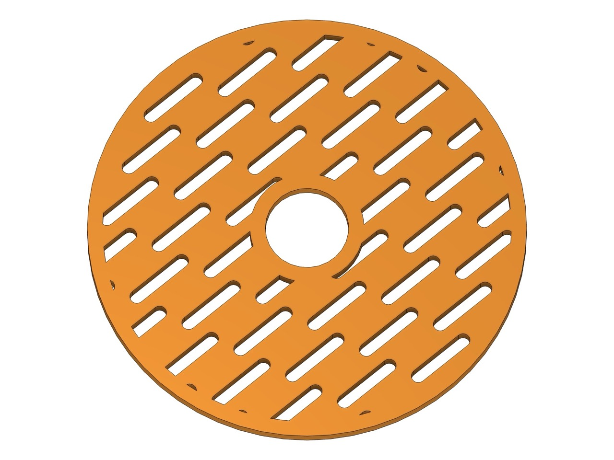
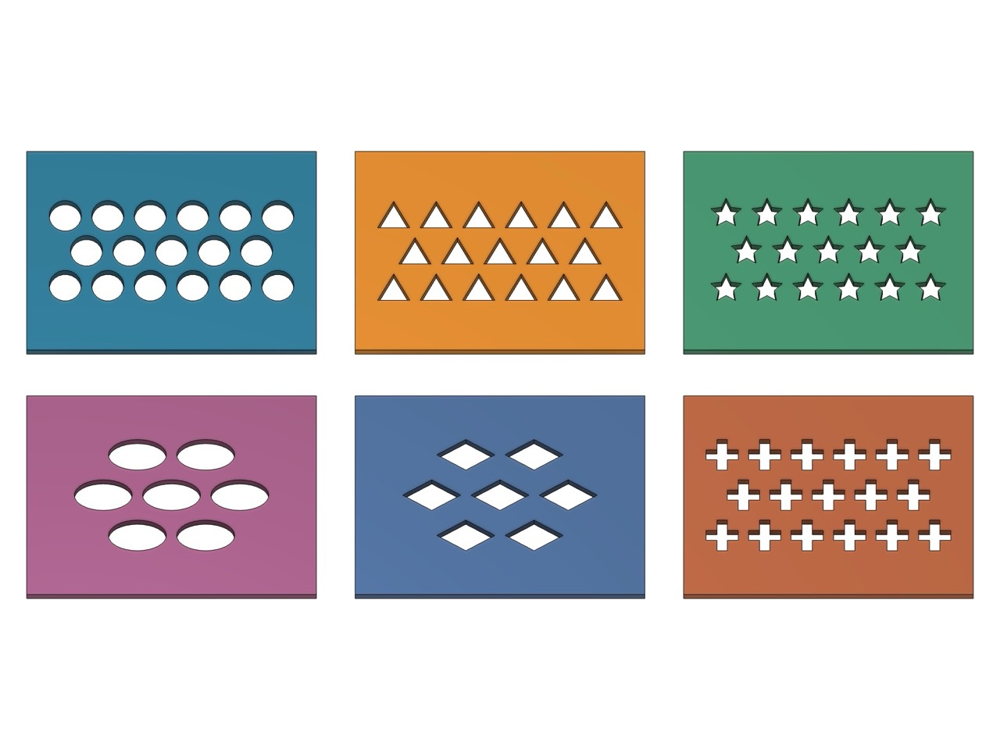

<h1 align="center">Perfora для Autodesk Fusion</h1>

<strong>Богиня отверстий. Точность в каждой детали.</strong> Перфорация, вентиляционные решётки и декоративные узоры — без ручного размещения каждого отверстия.

  
  
  

<a href="https://github.com/4FusionLab/Perfora/releases/latest"><strong>Скачать Perfora</strong></a> · <a href="README.md">English</a> · <a href="https://github.com/4FusionLab/Perfora/issues">Сообщить о проблеме</a>

---

## Что можно создать

<table>
<tr>
<td width="50%"> <strong>Вентиляционные решётки</strong> Аккуратные повторяющиеся отверстия.</td>
<td width="50%"> <strong>Органические узоры</strong> Вороной и нерегулярные рисунки.</td>
</tr>
<tr>
<td width="50%"> <strong>Круговые раскладки</strong> Радиальные и тангенциальные узоры.</td>
<td width="50%"> <strong>Разнообразие форм</strong> Настройка рисунка под задачу.</td>
</tr>
</table>

## Возможности

**Perfora** — аддон **Fusion 360** для создания массивов отверстий, сотовой и декоративной перфорации, вентиляционных решёток, узоров Вороного и параметрических панелей.

- **Гибкие узоры:** 12 повторяемых форм отверстий, 11 способов распределения, шесть органических полей и Вороной.
- **Контроль геометрии:** шаг, толщина перемычек, отступы, поворот и обрезка по границе.
- **Работа с моделью:** поддерживаемые плоские и криволинейные грани, профили эскизов и конструкционные плоскости.
- **Разные результаты:** эскиз, штатное выдавливание Fusion или параметрический элемент в истории.
- **Предпросмотр:** настройка узора до создания геометрии.

Доступность возможностей зависит от типа поверхности и режима результата. Подробнее — в [справке по совместимости](docs/README_REFERENCE.ru.md#совместимость-поверхностей-и-раскладок).

## Быстрый старт

1. Скачайте архив из **[последнего релиза](https://github.com/4FusionLab/Perfora/releases/latest)** и распакуйте его в постоянную папку.
2. В Autodesk Fusion откройте **Utilities → Scripts and Add-Ins**.
3. Нажмите **+ → Script or add-in from device** и выберите папку с файлами `Perfora.py` и `Perfora.manifest`.
4. Выберите **Perfora → Run**. Команда доступна в **Design → Solid → Create** и через поиск **S**.

Поддерживаются **Windows и macOS**. Не перемещайте папку после подключения. При таком способе установки отдельный Python не требуется.

## Подробнее

[Подробное руководство](docs/README_REFERENCE.ru.md) · [Геометрия отверстий](docs/PERFORATIONS.md) · [Органические узоры](docs/ORGANIC_PATTERNS.md) · [Что нового в 1.1.0](docs/releases/v1.1.0.md) · [История изменений](CHANGELOG.md)

[Участие в разработке](CONTRIBUTING.md) · [Лицензия](LICENSE) · [Сообщить о проблеме](https://github.com/4FusionLab/Perfora/issues)

**Другие аддоны Fusion 360 от 4FusionLab:** [Selectra — выбор похожей геометрии](https://github.com/4FusionLab/Selectra) · [Ejix — извлечение объёмов](https://github.com/4FusionLab/Ejix) · [RuEn — горячие клавиши при русской раскладке](https://github.com/4FusionLab/RuEn) · [Planara — будущая развёртка поверхностей](https://github.com/4FusionLab/Planara)

## Немного мифологии

**Перфора** — богиня отверстий, хранительница аккуратных кромок и противница ручного повторения узоров. Она входит в авторский пантеон **[4FusionLab](https://github.com/4FusionLab)**.

Независимый проект, не связанный с Autodesk и не одобренный ею.
