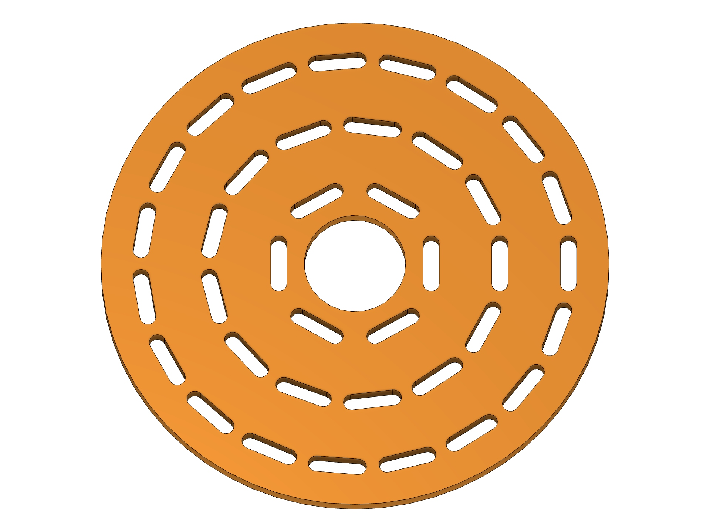
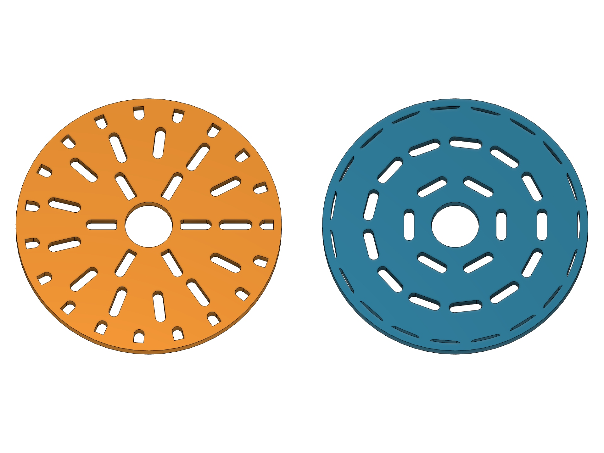
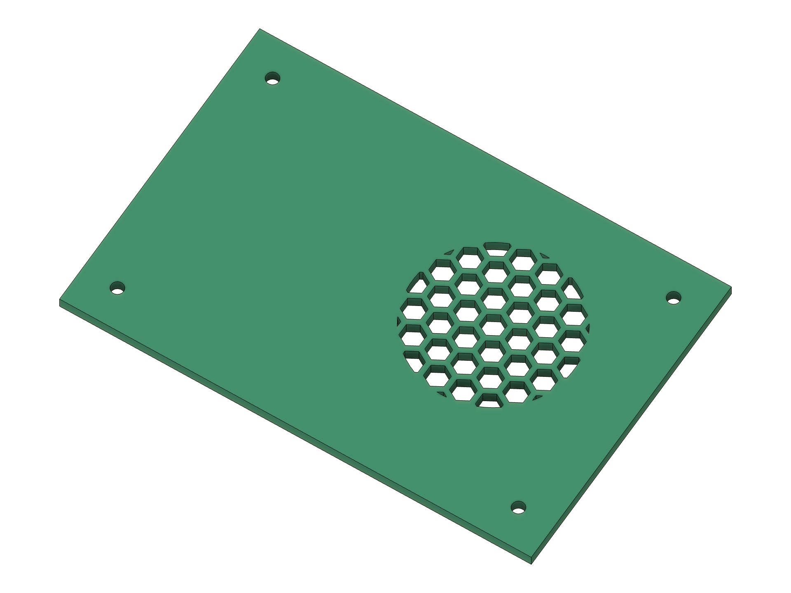
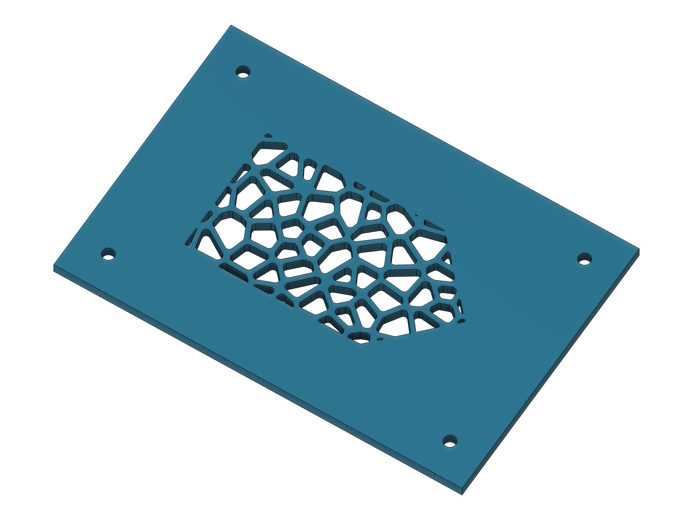
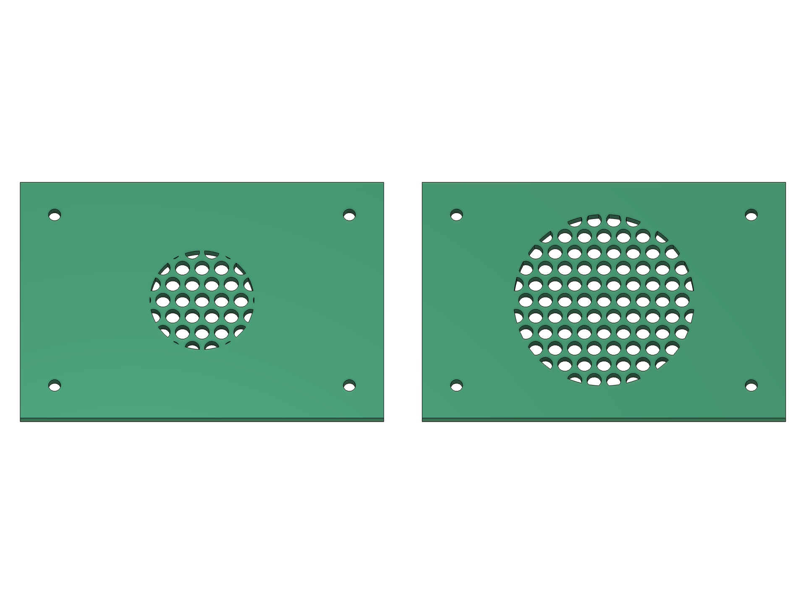

# Perfora 1.0.0 — первый стабильный выпуск

[English](v1.0.0.md)

**Перфорируйте выбранную область. Размещайте узор там, где он нужен. Сохраняйте параметричность.**

Perfora 1.0 — первый стабильный выпуск 4FusionLab. Он объединяет существующие тринадцать форм отверстий и параметрическую операцию Feature в таймлайне с круговыми узорами, размещением по точке, ограниченной областью, непосредственным выбором профиля эскиза и ускоренным предпросмотром.

[Скачать Perfora-1.0.0.zip](https://github.com/4FusionLab/Perfora/releases/download/v1.0.0/Perfora-1.0.0.zip) · [SHA-256](https://github.com/4FusionLab/Perfora/releases/download/v1.0.0/Perfora-1.0.0.zip.sha256) · [Английское руководство](https://github.com/4FusionLab/Perfora/blob/v1.0.0/README.md) · [Русская инструкция](https://github.com/4FusionLab/Perfora/blob/v1.0.0/README.ru.md)

## Что нового

- **Круговое распределение:** концентрические кольца для всех двенадцати повторяемых форм. Выберите ориентацию Fixed, Radial или Tangential, задайте Start Radius первого кольца и добавьте Hole Angle. Web Thickness сохраняется на стыке каждого кольца.
- **Start Point для любого распределения:** выберите точку эскиза, вершину или конструкционную точку штатным элементом Fusion Select. Точки за пределами исходной плоскости проецируются на неё. X/Y Offset смещает узор от этой точки.
- **Spread Radius:** ограничьте отверстия круглой зоной вокруг выбранного начала. Ноль заполняет выбранную границу. Для простой локальной перфорации дополнительный профиль не нужен. Edge Offset и точный Trim to Boundary продолжают действовать.
- **Профили непосредственно на гранях тел:** завершите эскиз границы и выберите его заштрихованный профиль в Profiles. Узор остаётся внутри области, а поддерживающее тело выбирается для Cut/Intersect. Split Face не требуется.
- **Feature по умолчанию:** новые команды начинают с параметрического узла Perfora в таймлайне. Измените штатный параметр, исходную границу или Start Point и пересчитайте узор. Sketch и штатный Extrude по-прежнему доступны.
- **Восстановление значений по умолчанию:** пустое значение любого из 36 числовых полей восстанавливает значение по умолчанию. Явный ноль, параметры документа, единицы и ошибки проверки непустых значений сохраняют своё значение.
- **Preview Color:** по умолчанию Gold, также доступны Cyan, Magenta, Green, White и Black. Контуры Fast Preview стали толще, а изменение цвета повторно использует подготовленную раскладку. Full Preview сохраняет внешний вид модели Fusion.

## Создано в Fusion

Это реальные CAD-результаты, полученные в Fusion с тем же белым фоном и цветными деталями, что и в существующей галерее.

| Круговые узоры | Radial и Tangential |
| --- | --- |
|  |  |
| Прорези следуют концентрическим кольцам вокруг центрального отверстия. | Меняется ориентация; круговое распределение сохраняется. |

| Точка и радиус | Эскиз задаёт границу |
| --- | --- |
|  |  |
| Смещённая круглая зона на существующей пластине; материал снаружи сохранён. | Скруглённые отверстия Voronoi внутри произвольного профиля, нарисованного на грани. |

**Измените радиус. Перестройте узор.** Обе панели начинаются с одинаковых настроек. Правая Feature пересчитана изменением параметра модели Spread Radius с 16 до 26 мм.

## Измерения производительности

Измерения сделаны **24 октября 2026 года на macOS arm64, Fusion 2706.1.14**. Сравнение до и после использует зафиксированный **снимок разработки до оптимизации с теми же возможностями раскладки**, а не опубликованный пакет 0.2.0. Алгоритмы сохраняют созданные ячейки и контуры: сравнительная матрица из 511 случаев не обнаружила расхождений.

### Генерация раскладки на чистом Python

Медиана трёх чередующихся измерений, включая подготовку индекса; нативный рендеринг, построение эскиза, обрезка BRep и Extrude исключены.

| Сценарий | Отверстий | До | После | Ускорение |
| --- | ---: | ---: | ---: | ---: |
| Шестиугольники, прямоугольная граница | 709 | 34,005 мс | 10,588 мс | 3,21× |
| Шестиугольники, круглая граница | 253 | 1 282,353 мс | 96,812 мс | 13,25× |
| Эллипсы, круглая граница | 45 | 4 027,185 мс | 263,233 мс | 15,30× |
| Voronoi, прямоугольная граница | 1 041 | 269,651 мс | 125,366 мс | 2,15× |

### Нативный Fusion: Fast Preview и последующее построение

Одиночные парные измерения в одном сеансе Fusion. Построение следует за Fast Preview, поэтому оптимизированная версия может повторно использовать ячейки, при этом читая текущий источник и создавая нативную геометрию.

| Сценарий | Отверстий | Fast Preview до → после | Построение до → после |
| --- | ---: | ---: | ---: |
| Шестиугольники внутри круга | 253 | 1,148 → 0,104 с | 2,453 → 2,193 с |
| Эллипсы внутри круга | 45 | 3,424 → 0,262 с | 3,683 → 0,263 с |
| Небольшая ограниченная касательная раскладка | 7 | 0,058 → 0,054 с | 0,105 → 0,107 с |

В небольшом ограниченном случае заметного ускорения построения нет. Создание нативного эскиза всё ещё может занимать основное время при плотном узоре. Результаты зависят от задачи; **15,30× — измеренное ускорение генерации геометрии, а не универсальное ускорение команды**.

Изменения фильтруют близкие рёбра границы перед точной проверкой, пропускают обрезку Voronoi без результата, разделяют неизменяемые подготовленные ячейки между Fast Preview и созданием, откладывают неиспользуемые булевы операции Panel и независимо кешируют подготовку источника, внутреннего отступа и зоны. Текущие настройки выдавливания применяются всегда, а изменение источника сбрасывает кеш.

[Полная методика и сценарии](https://github.com/4FusionLab/Perfora/blob/v1.0.0/docs/BENCHMARKS.md) · [Исходные измерения и отпечатки исходников](https://github.com/4FusionLab/Perfora/blob/v1.0.0/docs/benchmarks/v1.0.0.json) · [Повторить измерение геометрии](https://github.com/4FusionLab/Perfora/blob/v1.0.0/scripts/benchmark_layout.py)

## Установка и обновление

1. Скачайте и распакуйте ZIP в постоянную папку.
2. В Fusion откройте **Utilities → Scripts and Add-Ins → + → Script or add-in from device**.
3. Выберите внутреннюю папку **Perfora** с `Perfora.py` и `Perfora.manifest`, затем нажмите **Run**. Run on Startup включается по желанию.
4. Откройте **Design → Solid → Create → Perfora** или нажмите **S** и найдите Perfora.

Отдельная установка Python и сторонние пакеты среды выполнения не нужны. Необязательный установщик `install.py` сохраняет резервные копии предыдущих установок.

При обновлении папки, уже подключённой в Fusion, остановите и повторно загрузите аддон. При подключении другой папки остановите и отключите старую копию, затем перезапустите Fusion перед использованием Feature: Fusion может сохранить прежнего владельца Custom Feature в том же сеансе. Не запускайте обе копии. UUID манифеста, ID команды и пространство имён атрибутов документа не меняются.

Существующие узлы Feature версии 0.2 остаются редактируемыми. Новые штатные параметры Start Radius и Spread Radius присутствуют в новых узлах; старые узлы сохраняют редактируемые значения в настройках, но не могут получить эти дополнительные штатные параметры средствами текущего API. Если поля должны появиться в диалоге Parameters Fusion, создайте узел заново.

## Проверка и практические ограничения

- **67 тестов Python**, проверка компиляции, воспроизводимая сборка ZIP и установка с резервными копиями. GitHub Actions проверяет Python и упаковку на Linux, macOS и Windows перед публикацией именно этого коммита.
- **179 нативных CAD-сценариев** для форм, обрезки, Voronoi, кругового распределения, точек, операций и пересчёта Feature, профилей на гранях, поведения оптимизации и производительности предпросмотра.
- Приёмка реальных команд на **Fusion 2706.1.14 / macOS 27.0.1**: значения по умолчанию и выбор цвета, Fast/Full Preview, OK/Cancel, нативные Undo/Redo, редактирование параметров Feature и Extrude, локальное повторное открытие F3D и последующий пересчёт. Все тестовые документы временные; пользовательские документы не сохраняются.
- Нативный CAD Fusion на Windows, сохранение и повторное открытие через облако и сложные сборки **не заявлены как проверенные**. Windows CI не равнозначен нативной CAD-приёмке.
- Исходные объекты должны быть плоскими; криволинейные грани и сетки не поддерживаются. Edge Offset должен создавать корректный внутренний контур; Fusion может отклонить касающиеся или пересекающиеся петли смещения.
- Feature поддерживает прямую протяжённость **Distance** и **Join, Cut, Intersect, New Body**. Для All, To Object, уклона и New Component используйте штатный Extrude. Для редактирования и пересчёта Feature Perfora должна работать. Autodesk Custom Feature API по-прежнему имеет статус Preview; этот выпуск не меняет статус API Autodesk.
- Синяя подсветка выбора Fusion может окрашивать или перекрывать пользовательскую графику даже при выборе другого цвета предпросмотра. Более толстые контуры повышают контраст; Preview Color не переопределяет цвета выделения Fusion.
- Start Radius измеряется до центров отверстий и не гарантирует сплошную ступицу. Для некруглых колец применяется консервативный шаг; реальные перемычки могут быть шире заданных.

## По-русски

**Perfora 1.0.0 — первый стабильный релиз, без отметки prerelease.** В нём появились круговая раскладка с касательными и радиальными отверстиями, общая Start Point, ограничение Spread Radius, работа по профилю на грани без Split Face, восстановление пустых числовых полей и выбор цвета Fast Preview. Feature теперь выбирается по умолчанию.

Бенчмарки выше разделяют генерацию геометрии и настоящее построение Fusion: например, Fast Preview для 45 эллиптических отверстий сократился с 3,424 до 0,262 с. Это конкретные парные замеры на macOS, а не обещание такого ускорения для любой модели. Нативная работа Windows отдельно не проверялась.

[Подробная русская инструкция](https://github.com/4FusionLab/Perfora/blob/v1.0.0/README.ru.md)

Этот выпуск Perfora распространяется свободно по GPL-3.0-only и является независимым. Создан **4FusionLab** с любовью к чистым кромкам и неприязнью к размещению отверстий по одному.
