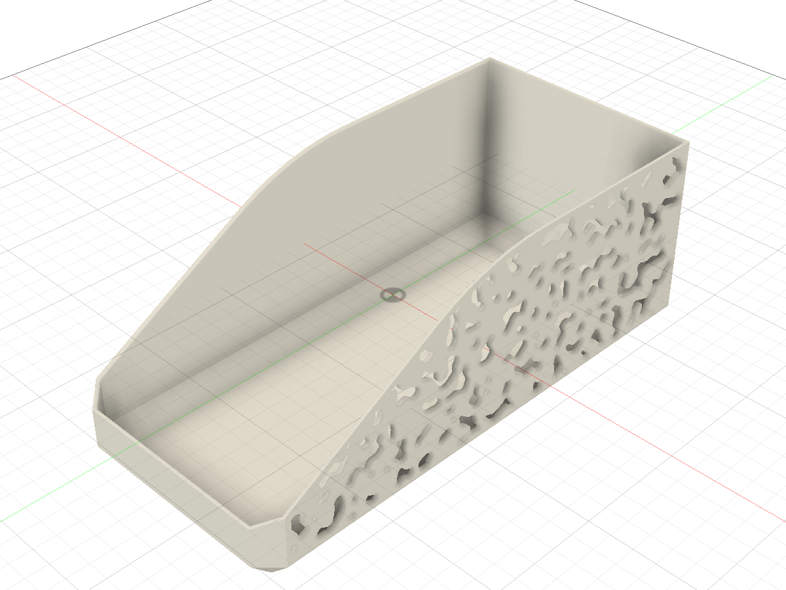

# Perfora 1.1.0

[English](v1.1.0.md)

Шумовые поля, больше способов распределения, криволинейные грани и надёжное параметрическое перестроение.

[Скачать Perfora-1.1.0.zip](https://github.com/4FusionLab/Perfora/releases/download/v1.1.0/Perfora-1.1.0.zip) · [SHA-256](https://github.com/4FusionLab/Perfora/releases/download/v1.1.0/Perfora-1.1.0.zip.sha256) · [Английское руководство](https://github.com/4FusionLab/Perfora/blob/v1.1.0/README.md) · [Русская инструкция](https://github.com/4FusionLab/Perfora/blob/v1.1.0/README.ru.md)

## Noise и Pattern

- **Pattern** содержит 12 повторяемых форм отверстий. **Noise** содержит Smooth Noise, Reaction Diffusion, Directional Fibers, Ridged Noise / Topographic, Gyroid Field, Blue Noise / Size Gradient и Voronoi последним пунктом.
- **Cell Size**, **Web Thickness**, **Edge Offset** и **Seed / New Pattern** определяют шум. Blue Noise использует Maximum Diameter; настройки полей предоставляют необязательные Add Bridges, вариацию размера и градиент, где это применимо. Процент заполнения скрыт; существующие Features сохраняют заданные пороги.
- Новые шумовые команды начинают с ячеек 8 мм и перемычки 0,8 мм. Для Fast Preview по умолчанию используется **Magenta**. Большие поля адаптируют дискретизацию в пределах фиксированного бюджета, сохраняя физический размер ячейки и безопасные частичные отверстия у границ.

Реальная операция Feature в Fusion после изменения Cell Size на 5,5 мм при перемычке 1,5 мм. Изображение сделано во время предшествующей CAD-приёмки и повторно использовано для этого выпуска.

## Размещение, поверхности и несколько областей

- **11 семейств Distribution:** Staggered, Rectangular, Circular, Along Path, Contour, Fan, Phyllotaxis, Poisson Disk, Wave, Chevron и Between Curves. Новые команды используют обновлённое общее ядро, включая ориентацию Follow Pattern и частичные варианты на границах. Сохранённые Features сохраняют версию алгоритма; старый Running Bond можно редактировать.
- Цилиндрические, конические и регулярные гладкие грани произвольной формы твёрдых тел используют те же сценарии Sketch, Extrude и Feature. Доступность Distribution зависит от типа источника.
- Можно выбрать до **32 областей одного типа поверхности** в одном компоненте с общими настройками и единым ограничением Maximum Holes. Плоские грани и плоские профили эскиза можно сочетать.
- Входящая в пакет **Pattern playground** запускает те же исходники Python для геометрии в браузере. Она включает все 19 форм, 11 семейств Distribution и связи параметров. О локальном запуске см. входящий в пакет `demo/README.md`; развёртывание размещённого демо в этот выпуск не входит.
- Концы строк исходников закреплены как LF, а сборщик демо явно читает UTF-8, что сохраняет согласованность хешей встроенного ядра, подписей и поставляемых исходников также в Windows.

## Пересчёт и редактирование Feature

Ссылки на объекты теперь привязываются к исходной геометрии до того, как её могут поглотить булевы операции. Это не позволяет Custom Feature зависеть от собственного результата. Edit Feature восстанавливает нужные тела и выделения, а после завершения команды восстанавливается таймлайн, поэтому Cancel сохраняет прежнюю модель и состояние узла.

Для существующего проблемного Feature откройте **Edit Feature** и один раз нажмите **OK**, чтобы обновить ссылки Object. Существующие Features остаются читаемыми. Операции, созданные до новых штатных параметров пути, нужно создать заново для использования Along Path и зависимостей выражений.

## Установка и обновление

Распакуйте ZIP в постоянную папку. В Fusion остановите существующий аддон Perfora, затем выберите внутреннюю папку **Perfora** через **Utilities → Scripts and Add-Ins → Add-Ins → +** и запустите её. Одновременно используйте одну копию. Установщик необязателен и сохраняет резервную копию предыдущей установки. UUID манифеста, ID команды, пространство имён атрибутов документа и лицензия GPL-3.0-only этого выпуска не изменились.

## Зафиксированные проверки и ограничения

До подготовки релиза прошли **200 тестов Python** и **36 сценариев браузера**. Нативная приёмка выполнялась на **Fusion 2706.1.14 / macOS 27.0.1 (Apple Silicon)** и включала:

- Создание Feature и пересчёт Cell Size для всех шести шумовых полей и Voronoi на копиях выбранной грани реальной модели Box.
- Реальные Fast/Full Preview, Edit Feature OK/Cancel, Undo/Redo создания и редактирования и восстановление старого откатанного узла.
- Cut, Join, Intersect и New Body для нескольких областей; изменение толщины исходного тела.
- Представительные случаи Smooth Noise на цилиндре, конусе и поверхности произвольной формы, а также локальный экспорт F3D, повторное открытие и новый пересчёт по параметру.

При подготовке релиза локальные тесты и проверки Fusion **не повторялись**. Существующий workflow GitHub Actions собирает коммит релиза, выполняет обычную матрицу проверок Python, установки и упаковки на Linux, macOS и Windows и публикует ZIP и контрольную сумму из CI.

Работа над производительностью включает ограниченную дискретизацию и общее кеширование; новый коэффициент ускорения CAD не заявляется. Существующие сценарии измерений различают генерацию раскладки на чистом Python, чтение исходников, предпросмотр и нативное построение. Регрессионная проверка шума на реальной грани использует ячейки 5 мм, перемычку 1,5 мм и отступ от края 3 мм до изменения Cell Size.

Приёмка нативного CAD в Windows и облачного сохранения не заявляется. Custom Feature использует Preview API Autodesk и требует работающего Perfora. Feature поддерживает Distance с нулевым уклоном; для дополнительных вариантов протяжённости и New Component используйте штатный Extrude. Для криволинейных отверстий используются конечные прямые инструменты с консервативным разделением по швам и кривизне. Типы поверхностей смешивать нельзя; сферы, торы и сеточные тела не поддерживаются. Contour использует дискретизированные уровни расстояния, а Between Curves требует две поддерживаемые открытые плоские направляющие.

## По-русски

Выпуск добавляет шесть шумов, переносит Voronoi в раздел Noise и разделяет настройки Noise/Pattern. Вместо процента заполнения используются размер ячеек и толщина перемычек; цвет Fast Preview по умолчанию — Magenta.

Доступны 11 Distribution, криволинейные грани и до 32 областей одного типа. Исправлены пересчёт Feature, восстановление Objects, Edit Feature OK/Cancel и Undo/Redo. Для старого проблемного узла достаточно один раз открыть **Edit Feature → OK**. ZIP собирается и публикуется существующим CI; локальные и CAD-проверки при подготовке релиза повторно не запускаются.
